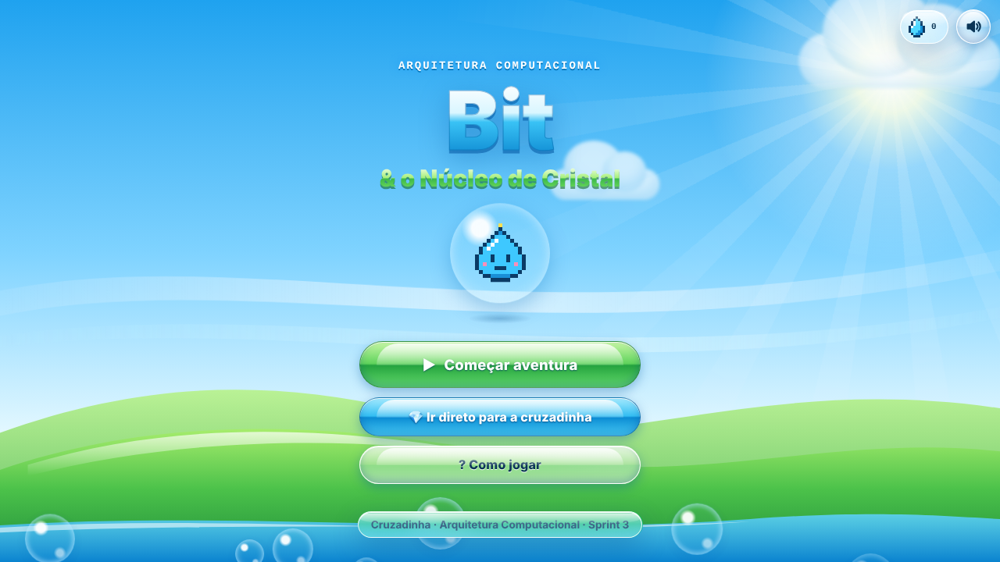
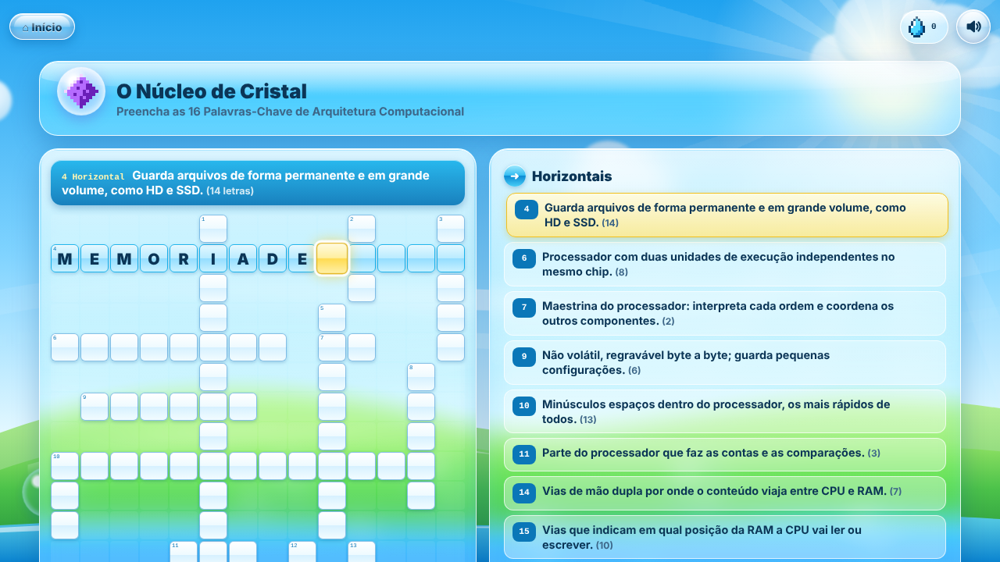

<div align="center">

# 💧 Bit & o Núcleo de Cristal

### Uma cruzadinha de **Arquitetura Computacional** com história, pixel art e visual Frutiger Aero


### 🎮 [**JOGAR AGORA**](https://pietrogds.github.io/arqcomp_cruzadinha_sprint3_pietrogds/)

`https://pietrogds.github.io/arqcomp_cruzadinha_sprint3_pietrogds/`



</div>

---

## 📖 A história

> *Ano 2007. Num quarto qualquer, um velho PC zumbia baixinho em cima da escrivaninha...*

Dentro dele existe a **Aeroplaca**, um mundo de trilhas de cobre e bolhas de luz. O vilão **Glitch** 👾 embaralhou as **16 Palavras-Chave** do **Núcleo de Cristal**, e sem elas o computador nunca mais liga.

Você é o **Bit** 💧, uma gotinha-robô. Junto com a **Aura** 🐟, a peixinha guardiã do aquário de dados, você atravessa as regiões da placa, aprende os conceitos e reconstrói o Núcleo resolvendo a cruzadinha.

| Região | O que você aprende |
|:--|:--|
| 🔵 **Ilha do Processador** | CPU, ULA, UC, registradores e o ciclo buscar → decodificar → executar |
| 🟢 **Lagoa das Memórias** | RAM, ROM, EEPROM, Flash, cache, memória de massa e a hierarquia de memória |
| 🟠 **Ponte dos Barramentos** | Address bus, data bus e DMA |
| 🟣 **Torre dos Núcleos** | Microcontrolador, dual core e quad core |
| 💎 **Núcleo de Cristal** | A cruzadinha final com as 16 palavras |

---

## 🕹️ Como jogar

Na tela inicial dá pra escolher entre dois caminhos:

- **▶ Começar aventura:** segue a história, visita as regiões no mapa e responde às perguntas. Cada resposta certa vale uma **gota de energia** 💧.
- **💎 Ir direto para a cruzadinha:** vai direto para o tabuleiro.

### Na cruzadinha

1. Clique numa casa do tabuleiro (ou numa pista da lista) e **digite as letras direto nas casas**.
2. Clique de novo na mesma casa para alternar entre **horizontal** e **vertical**.
3. Aperte **✔ Conferir** para ver quais palavras estão **certas (verde)** e quais estão **erradas (vermelho)**. O contador mostra algo como **"8 de 16 palavras"**.
4. Travou? Gaste uma gota em **💧 Revelar letra**.
5. **↺ Reiniciar** limpa o tabuleiro.

### Atalhos de teclado

| Tecla | Ação |
|:--:|:--|
| `A`–`Z` | Escreve a letra e pula para a próxima casa |
| `←` `→` `↑` `↓` | Anda pelo tabuleiro |
| `Backspace` | Apaga e volta uma casa |
| `Espaço` / `Enter` | Troca entre horizontal e vertical |
| `Tab` / `Shift + Tab` | Vai para a próxima / anterior palavra |

> 💡 Letras com acento são convertidas sozinhas (`Ó` vira `O`), e o progresso fica salvo no navegador.

<div align="center">

</div>

---

## 🧩 Palavras e pistas

O tabuleiro usa **todas as 16 palavras** da lista, e cada uma cruza com pelo menos outra.

### ➜ Horizontais

| Nº | Pista | Resposta |
|:--:|:--|:--|
| 4 | Guarda arquivos de forma permanente e em grande volume, como HD e SSD. | MEMORIADEMASSA |
| 6 | Processador com duas unidades de execução independentes no mesmo chip. | DUALCORE |
| 7 | Maestrina do processador: interpreta cada ordem e coordena os outros componentes. | UC |
| 9 | Não volátil, regravável byte a byte; guarda pequenas configurações. | EEPROM |
| 10 | Minúsculos espaços dentro do processador, os mais rápidos de todos. | REGISTRADORES |
| 11 | Parte do processador que faz as contas e as comparações. | ULA |
| 14 | Vias de mão dupla por onde o conteúdo viaja entre CPU e RAM. | DATABUS |
| 15 | Vias que indicam em qual posição da RAM a CPU vai ler ou escrever. | ADDRESSBUS |

### ⬇ Verticais

| Nº | Pista | Resposta |
|:--:|:--|:--|
| 1 | Chip que junta processador, memória e periféricos; o coração do Arduino. | MICROCONTROLADOR |
| 2 | Guarda os aplicativos abertos agora, mas perde tudo ao desligar. | RAM |
| 3 | Pequena e rapidíssima, guarda perto da CPU o que é mais usado. | CACHE |
| 5 | Processador com quatro unidades de execução trabalhando em paralelo. | QUADCORE |
| 8 | Tecnologia regravável em blocos usada em pendrives, cartões SD e SSDs. | FLASH |
| 10 | Vem gravada de fábrica e normalmente não pode ser alterada. | ROM |
| 12 | Deixa um periférico copiar dados para a RAM sem ocupar a CPU. | DMA |
| 13 | O cérebro do computador: busca, decodifica e executa as instruções. | CPU |

<details>
<summary>📐 Ver o gabarito do tabuleiro (spoiler!)</summary>

```
. . . . . M . . . . R . . C
M E M O R I A D E M A S S A
. . . . . C . . . . M . . C
. . . . . R . . . Q . . . H
D U A L C O R E . U C . . E
. . . . . C . . . A . . F .
. E E P R O M . . D . . L .
. . . . . N . . . C . . A .
R E G I S T R A D O R E S .
O . . . . R . . . R . . H .
M . . . . O . . . E . . . .
. . . . U L A . D . C . . .
. . . . . A . . M . P . . .
. . . . . D A T A B U S . .
. . . . . O . . . . . . . .
. . A D D R E S S B U S . .
```

</details>

---

## ✨ Recursos

- 🫧 **Visual Frutiger Aero:** céu azul, colinas brilhantes, vidro translúcido, botões "aqua" e bolhas que dá pra estourar
- 👾 **Personagens em pixel art** desenhados em `<canvas>`, direto no código, sem nenhuma imagem
- 💬 **Diálogos** com efeito de máquina de escrever
- 🗺️ **Mapa** com regiões que vão sendo desbloqueadas
- ❓ **18 perguntas** de múltipla escolha com explicação de cada resposta
- 💧 **Gotas de energia** que viram dicas na cruzadinha
- 🔊 **Sons sintetizados** com a Web Audio API (com botão para desligar)
- 💾 **Progresso salvo** no navegador (`localStorage`)
- 📱 **Responsivo:** funciona no PC e no celular

---

## 🗂️ Estrutura do projeto

```
📁 arqcomp_cruzadinha_sprint3_pietrogds
├── index.html          → página principal
├── style.css           → visual base (céu, vidro, botões, bolhas)
├── script.js           → núcleo do jogo (telas, HUD, salvamento)
├── css/
│   ├── cruzadinha.css  → visual do tabuleiro
│   └── historia.css    → diálogos, mapa, quiz e final
├── js/
│   ├── audio.js        → efeitos sonoros
│   ├── pixel.js        → sprites em pixel art
│   ├── palavras.js     → palavras, pistas e posições no tabuleiro
│   ├── cruzadinha.js   → lógica da cruzadinha
│   ├── perguntas.js    → regiões, falas e perguntas
│   └── historia.js     → modo aventura
└── docs/               → imagens do README
```

---

## 🚀 Como rodar

**Online:** é só abrir o [link do jogo](https://pietrogds.github.io/arqcomp_cruzadinha_sprint3_pietrogds/).

**No computador:** baixe ou clone o repositório e abra o `index.html` no navegador. Não precisa instalar nada.

```bash
git clone https://github.com/pietrogds/arqcomp_cruzadinha_sprint3_pietrogds.git
```

---

## 📝 Padrão de commits

| Tipo | Uso |
|:--|:--|
| `feat` | nova funcionalidade |
| `fix` | correção de bug |
| `style` | mudanças visuais |
| `docs` | documentação |

---

<div align="center">

Feito com 💙 para a disciplina de **Arquitetura Computacional** · Sprint 3

*Agora estoura uma bolha aí. 🫧*

</div>
